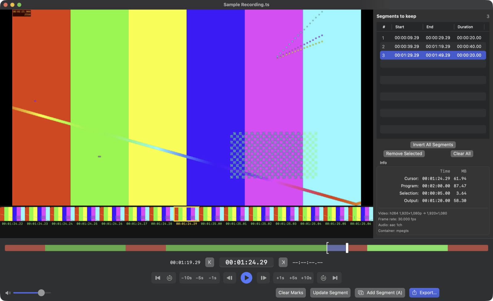

# K24 Cutter

macOS app (Swift / SwiftUI) for cutting TV recordings (.ts / .m2ts / .mp4 / .mkv) **frame-exact, without re-encoding the whole video**. Like VideoReDo's smart rendering, only the few frames between each cut and the nearest keyframe are re-encoded; everything else is stream-copied with ffmpeg. The layout follows VideoReDo.

**Download:** [latest release](https://github.com/27sec/K24-Cutter-2/releases/latest) (v1.1, universal: Apple Silicon + Intel, macOS 13 or later)

## Install
1. Download `K24-Cutter-2-v1.1-macOS.zip`, unzip it, and move **K24 Cutter 2.app** to Applications.
2. Install ffmpeg: `brew install ffmpeg`. It is not bundled. Frame-exact cuts use its libx264, libx265 and mpeg2video encoders, which the Homebrew build includes.
3. The app is not notarized, so macOS blocks the first launch. Right-click the app → **Open**, or run:
   `xattr -dr com.apple.quarantine "/Applications/K24 Cutter 2.app"`

## What's new in v1.1
- **Frame-exact cuts**: segments start and end exactly on the marked frames instead of snapping to the previous keyframe, which could start up to about 0.5 s early. See [How cuts work](#how-cuts-work).
- Fixed: a segment starting at 0:00 no longer repeats the first frame.
- Fixed: cutting MPEG-TS no longer sometimes starts at the keyframe *after* the mark.
- The segment table columns now fit, so Duration shows in full.

## Build
    brew install ffmpeg        # needs ffmpeg + ffprobe
    ./build_app.sh             # build + install to /Applications/K24 Cutter 2.app
    ./build_app.sh --no-install   # build only (dist/)
    ./build_app.sh --universal    # Apple Silicon + Intel binary
    ./build_app.sh --release      # universal + dist/K24-Cutter-2-v<ver>-macOS.zip for a GitHub release
    swift tools/make_icon.swift   # regenerate icon

## Usage
1. Open a file (⌘O) or drag it onto the window.
2. Move to the start point, press `[` / `I` (or the ⇤ button) = Trim Start.
3. Move to the end point, press `]` / `O` (or the ⇥ button) = Trim End.
4. Press `A` / "Add Segment" to add it to the Segment list. Repeat for every part you want to keep.
5. Click "Export…" and choose the container (same as source / TS / MP4 / MKV) and whether to join into one file or write one file per segment.

## Keyboard shortcuts
Space = play/pause · ←/→ = 1 frame · ⇧←/→ = 1 s · ⌥←/→ or J/L = 10 s · PgUp/PgDn = 1 min · Home/End
Double-click a segment = load it into the marks for editing, then "Update Segment" · Delete = remove selected segments

## How cuts work
Each segment starts and ends exactly on the marked frames (the frame at the end mark is not included):

- **Head**: frames from the start mark up to the first IDR keyframe are re-encoded (H.264 → libx264, HEVC → libx265, MPEG-2 → mpeg2video, high quality, same pixel format and field order).
- **Middle**: everything from that keyframe on is stream-copied untouched.
- **Tail**: frames after the last usable keyframe up to the end mark are re-encoded.
- **Audio** is stream-copied (packets whose middle lies inside the segment).

Usually that is well under a second of re-encoded video per cut. If a segment has no IDR keyframe near its start (open-GOP H.264/HEVC broadcasts), the whole segment is re-encoded, because splicing in front of an open-GOP I-frame would show frames in the wrong order. Codecs other than H.264, HEVC and MPEG-2 fall back to plain stream copy, where cuts snap to the keyframe before the mark. The Export window shows which mode applies to the open file.

To check an export without the UI:

    "dist/K24 Cutter 2.app/Contents/MacOS/K24Cutter" --cuttest <input> <output.ts|mp4|mkv> <start> <end> [<start> <end> …]

## License

MIT — see [LICENSE](LICENSE). ffmpeg/ffprobe are separate programs under their own (LGPL/GPL) licenses and are not bundled.
